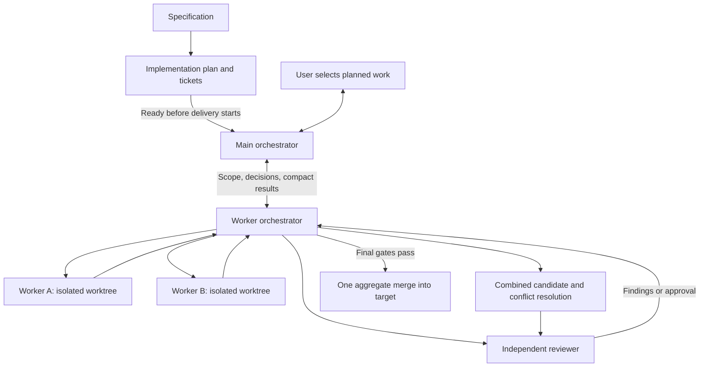

# Feature delivery skills

Prepare the specification and implementation plan first. Then use the delivery skills to execute selected planned work through two levels of orchestration. Talk to the main orchestrator. It delegates technical work to a separate named worker-orchestrator chat and retains only compact checkpoints and decisions. Implementation workers and reviewers also get separate named chats by default.



| Skill | Responsibility |
| --- | --- |
| [feature-orchestrate](skills/feature-orchestrate/SKILL.md) | User-facing main chat: scope, delegation, decisions, compact results |
| [feature-worker-orchestrate](skills/feature-worker-orchestrate/SKILL.md) | Split selected scope, assign workers, run review loops, resolve conflicts, integrate and merge |
| [feature-spec](skills/feature-spec/SKILL.md) | Define behavior, technical decisions, and acceptance criteria |
| [feature-plan](skills/feature-plan/SKILL.md) | Prepare implementation plan and tickets before orchestration |
| [feature-implement](skills/feature-implement/SKILL.md) | Implement or repair an assigned child task in a separate worktree |
| [feature-test](skills/feature-test/SKILL.md) | Verify acceptance criteria and run required checks |
| [feature-review](skills/feature-review/SKILL.md) | Independently review code; return findings to the worker orchestrator |

## How a request runs

1. Finish the spec and plan using the preparation skills. Then tell the main orchestrator which planned ticket, function, or feature to implement, where both documents are, and the merge target.
2. It verifies the prerequisites, then creates or resumes one worker-orchestrator chat with the existing spec/plan references and a compact assignment. Missing or blocked documents stop dispatch.
3. The worker orchestrator reads the code and existing documents, then divides the selected planned scope into worker assignments. It does not create or rewrite the spec or implementation plan. A small function may need only one worker. Independent tasks run concurrently; shared contracts and overlapping edits are ordered.
4. Workers implement in isolated worktrees and return committed changes and test evidence to the worker orchestrator.
5. Tickets with passing checks proceed to integration. An earlier independent review is required only by repository or user rules, or for a specific dependency risk recorded by the coordinator.
6. The worker orchestrator tests the combined result and assigns one independent review of the full selected scope. Reviewers return a consolidated findings batch. Workers repair the affected code, and the same reviewer checks the combined repair diff and issues a verdict for the new head.
7. When authorized and all gates pass, the worker orchestrator performs one aggregate merge into the named target and returns a compact result to main. Child branches never merge into that target independently.

Two implementation workers run by default, within the host's capacity including both orchestrators and reviewers. Repair loops allow three rounds per child task and three for the combined request. Exhausted budgets become recorded blockers; independent work may continue.

## Install in Codex

Install all seven skills together from this public repository because they reference each other. With Node.js and npm available, run:

```bash
npx skills@latest add maddindeiss/my-dev-skills --agent codex --skill '*' --global --yes
```

This installs the complete set for Codex across your projects. Omit `--global` and run the command from a target project to install only there. Keep the quotes around `'*'` so your shell does not expand it. `--yes` skips the skills CLI's confirmation prompts.

You can preview the available skills without installing them:

```bash
npx skills@latest add maddindeiss/my-dev-skills --list
```

See the [skills CLI documentation](https://github.com/vercel-labs/skills/blob/main/docs/commands.md) for available options.

Codex discovers installed skills automatically; restart if they do not appear. See [official skill documentation](https://learn.chatgpt.com/docs/build-skills#where-codex-loads-local-skills).

Files under this repository's `skills/` are source files, not a global installation. Normal skill discovery remains enabled; discovery itself does not grant tool permissions.

## Prompts

Complete preparation before starting any orchestrator:

```text
Use $feature-spec to define saved searches in docs/features/saved-searches/.
Then use $feature-plan to create the feature plan and Markdown tickets.
Stop before implementation so I can inspect the plan.
```

Then select a ticket from the chat you want as the main orchestrator. Replace the example scope and target with your actual ones:

```text
Use $feature-orchestrate to deliver T-002 from
docs/features/saved-searches/tickets/T-002.md.
The completed spec is docs/features/saved-searches/spec.md
and the completed plan is docs/features/saved-searches/plan.md.
Keep this chat as my main orchestrator. Create separate Codex chats in isolated
worktrees for the worker orchestrator, implementation workers, and reviewers.
Have the worker orchestrator create and message the worker and reviewer chats.
You may message the coordinator with assignments and decisions. The coordinator
may send compact skill-selection updates back to this main chat when I give it
instructions directly. Let it split this ticket into child tasks, handle review
rounds and conflicts, and perform one final merge into the local main branch
after all required checks and independent review pass.
Do not push or deploy. Keep detailed worker discussion out of this main chat.
```

You can select a function instead: name its file/function and the section of the existing spec and plan that defines the work. The worker orchestrator only divides that decided work into execution assignments. If delivery reveals a missing requirement or design decision, affected work pauses and returns to the separate spec/plan phase; it resumes from the updated document revisions. For a remote PR, name the repository, target branch, and whether to open one aggregate PR or also merge it. To inspect before merging, say to prepare the combined branch and stop at Ready to merge.

If your request only says to implement the plan, the main orchestrator asks for any missing chat permissions before dispatch. It passes the original authorization reference to the coordinator. If the receiving chat cannot verify it, it reports the missing scope and waits. Results are collected through chat snapshots, so reverse messages are unnecessary.

Resume from the main chat:

```text
Use $feature-orchestrate to resume the absolute request.md path from the previous delivery checkpoint.
Reuse the worker orchestrator and its workers. You may message that coordinator;
it may resume or replace its workers/reviewers in isolated worktrees and send
repair assignments. Keep the previously agreed scope and delivery mode.
```

## Optional skill selections

You can leave **Requested skills** out entirely. It is an optional field in the spec, plan, and delivery handoffs; no skill selection is needed to start. When you do select one, the chain passes its name, source, scope, and applicable roles to the workers and reviewer. You can just use plain language rather than fill out a form.

In the main chat:

```text
For this ticket, use $impeccable for UI changes, including existing UI work.
Pass it to the worker orchestrator, relevant workers, and reviewer.
```

Or directly in the worker-orchestrator chat:

```text
Use $impeccable for this request's UI changes. Tell the main orchestrator
about this update as well; you may send that compact update to the main chat.
```

The worker orchestrator records the instruction, forwards it to affected workers, and checks existing output against it. Backend-only workers record that a UI skill does not apply. Review checks compliance; it never runs editing steps merely because the selected skill includes them.

Direct instructions generate a uniquely identified update. Main records it and acknowledges the new skill-selection revision. The worker coordinator keeps resending the pending update in checkpoints until acknowledged, so resuming either chat does not lose it. When reverse messaging is authorized it sends the compact update directly too. If main is idle and messaging cannot wake it, synchronization remains visibly pending until main resumes; final completion/merge waits for it. Compatible updates do not require you to repeat your instruction.

Missing selected skills block only affected work. Adding a skill after code review requires new evidence and review for that scope, even when the code has not changed. Concurrent or repeated updates cannot restore an older selection. Omitting the field on later messages keeps existing selections; explicitly ask to remove or clear them when desired. Skill selection does not alter the spec/plan-first workflow or grant extra publishing/merge authority.

## State, reviews, and merges

The main owns a small request.md in a separate control worktree so its updates do not dirty the merge target: scope, coordinator ID, optional skill selections and their revision, acknowledged update IDs, decisions, and latest checkpoint. The completed spec and plan remain canonical inputs. The worker orchestrator owns execution assignments, child-task records, run.md, checks, and review reports in its control worktree. Absolute paths identify the authoritative records. It handles resumption and reconciliation of its own workers; main does not load their transcripts.

Approvals name exact commits. New code, conflict resolution, or target changes require renewed relevant checks and review. Integration candidates are tested before advancing the verified request branch. A changed target is reconciled before the single final target update. Merge intent and outcome are recorded so interrupted runs do not merge twice.

The spec and plan both show implementation status. A fully verified feature is marked `Implemented`. Delivery of a subset is marked `Partially implemented`, with the covered scope listed. These status edits are included in the reviewed delivery candidate when the documents are in the repository.

Final verdict and completion records remain explicitly listed local evidence after approval, preserving the reviewed commit. A prepared branch, an open PR, and a completed merge are reported as different outcomes. Merging does not include deployment.

Live delivery requires Git with an initial commit, usable check commands, and the appropriate Codex chat and worktree tools. Internal subagents are an explicit opt-in for implementation and review roles. Shared host limits count the whole hierarchy.
